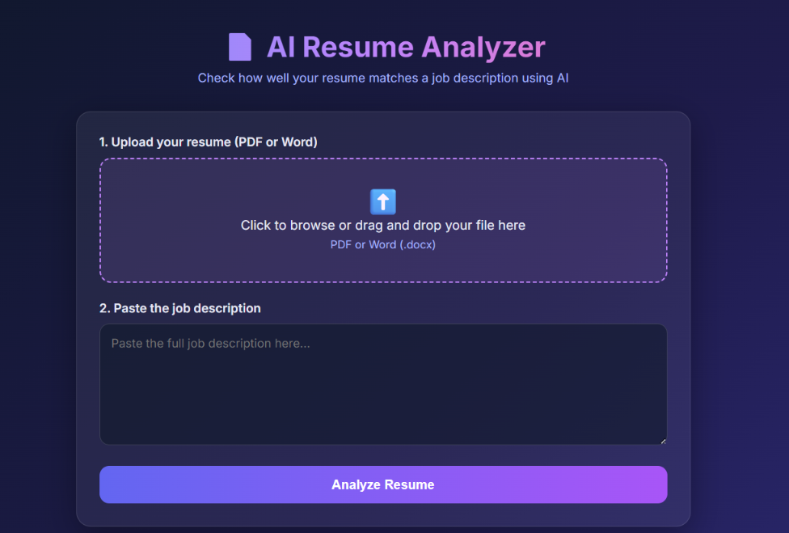
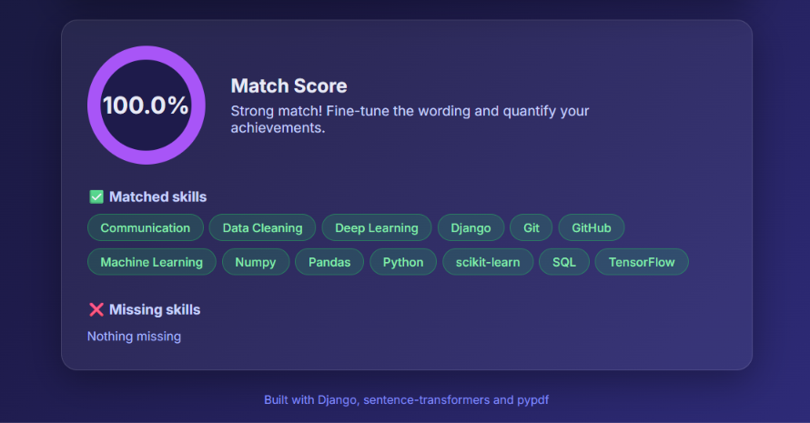
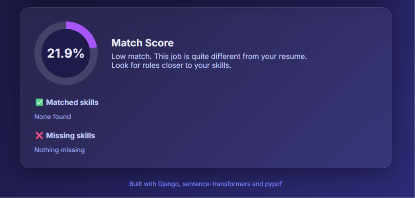

# AI Resume Analyzer

An AI-powered Resume Analyzer built using Python and Django. This project helps users upload their resumes and analyze how well they match a given job description.

## Features

- Upload resumes through a web interface.
- Enter job descriptions for comparison.
- Analyze resume and job description matching.
- Display a match score.
- Simple and user-friendly interface.

## Technologies Used

- Python
- Django
- HTML
- CSS
- SQLite
- Git and GitHub

## Project Structure

```text
resume-analyzer/
│
├── analyzer/
│   ├── migrations/
│   ├── templates/
│   │   └── analyzer/
│   │       └── home.html
│   ├── models.py
│   ├── views.py
│   └── admin.py
│
├── config/
│   ├── settings.py
│   ├── urls.py
│   ├── asgi.py
│   └── wsgi.py
│
├── screenshots/
│   ├── form.png
│   ├── high_score.png
│   └── low_score.png
│
├── manage.py
├── requirements.txt
└── .gitignore
```

## Installation and Setup

### 1. Clone the repository

```bash
git clone https://github.com/YOUR_USERNAME/resume-analyzer.git
```

### 2. Navigate to the project folder

```bash
cd resume-analyzer
```

### 3. Create a virtual environment

```bash
python -m venv venv
```

### 4. Activate the virtual environment

For Windows:

```bash
venv\Scripts\activate
```

### 5. Install dependencies

```bash
pip install -r requirements.txt
```

### 6. Run database migrations

```bash
python manage.py migrate
```

### 7. Start the development server

```bash
python manage.py runserver
```

Open your browser and visit:

```text
http://127.0.0.1:8000/
```

## Screenshots

### Resume Upload Form



### High Match Result



### Low Match Result



## Future Improvements

- Improve resume analysis accuracy.
- Add more advanced AI-based matching.
- Support additional resume formats.
- Provide detailed skill-gap analysis.

## Author

Nanditha

---

**Note:** This project is developed for learning and demonstration purposes.